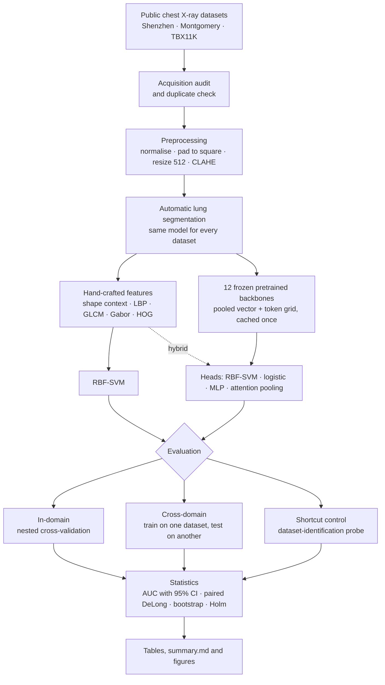

# ThoraxShift

## Summary

Automated tuberculosis (TB) screening from chest X-rays can perform well on the dataset it was
built on, yet lose accuracy at a new site with different scanners, image resolutions and patient
populations. This project measures that loss for two kinds of representation, **with the
classifier held fixed**:

- **Hand-crafted:** thoracic edge-map shape descriptors (log-polar shape context) and texture
  descriptors (LBP, GLCM, Gabor, HOG) inside automatically segmented lung regions (FUSION).
- **Deep, frozen:** twelve pretrained backbones used as fixed feature extractors: ImageNet CNNs
  (ResNet-18/50, DenseNet-121, EfficientNet-B0, ConvNeXt-T), ImageNet transformers (Swin-T,
  ViT-S/16, ViT-B/16), self-supervised natural-image models (DINOv2 ViT-S/14, ViT-B/14) and chest
  X-ray models (TorchXRayVision DenseNet-121, RAD-DINO).

Both feed the same RBF-SVM (primary). Three more heads (logistic regression, MLP, gated attention
pooling over the spatial tokens) check that conclusions do not depend on the classifier, and a
hybrid model tests whether the hand-crafted features add to the deep ones.

Each model is trained on one public collection (Shenzhen, Montgomery, TBX11K) and tested on the
others without any tuning on the test collection. Statistics: ROC AUC with 95% CIs, paired DeLong
tests confirmed by a paired bootstrap, Holm correction over fixed families, sensitivity and
specificity at a threshold fixed on the training collection, and a dataset-identification probe
for shortcut learning. The full protocol is in [docs/analysis_plan.md](docs/analysis_plan.md).

## Research flow



## Running everything

Prerequisites: `data/manifests/<dataset>.csv`, `data/prepared/<dataset>_s512/` and
`data/masks/<dataset>_s512/` (from `scripts/download_data.py`, `scripts/prepare_images.py`,
`scripts/segment_lungs.py`). Set `TBSHIFT_DATA` / `TBSHIFT_RUNS` to relocate data and runs.

```bash
pip install -r requirements.txt
python -m pytest                                              # unit tests
python scripts/extract_deep_features.py --prefetch            # download all backbone weights once
python scripts/run_experiments.py --dry-run                   # what will run
python scripts/run_experiments.py                             # everything; safe to re-run (resumes)
```

`run_experiments.py` runs, in order: cache check → hand-crafted features → deep features
(12 backbones × 3 datasets × 2 masks) → hand-crafted runs → frozen-backbone runs → shortcut probe
→ aggregation → figures. Logs go to `outputs/logs/`. With several GPUs, see `docs/compute.md`.

Results land in `outputs/runs/<stamp>_aggregate_benchmark/`:
- `summary.md`: headline numbers (primary endpoint, leaderboard, source-selected model, heads,
  contrasts, hybrid gain, shortcut probe);
- `tables/*.csv|tex`: every table in the plan; `results.json`; `inputs.json` (run ids used).

Figures land in `outputs/figures/` (`figB1`–`figB8`, PDF + SVG).

## Code map

| path | role |
|---|---|
| `src/tbshift/study.py` | the study design (datasets, pairs, primary family, repeats) |
| `src/tbshift/models/backbones.py` | backbone registry, input conversion, pre-specified contrasts |
| `src/tbshift/models/heads.py` | the four heads (sklearn-compatible) |
| `src/tbshift/deep_features.py` | feature cache layout |
| `src/tbshift/eval/` | protocols, metrics (DeLong, bootstrap, Holm), shortcut probe |
| `scripts/extract_deep_features.py` | frozen feature extraction |
| `scripts/run_frozen.py` / `run_classical.py` | one run (deep / hand-crafted) |
| `scripts/run_experiments.py` | end-to-end driver |
| `scripts/aggregate_benchmark.py` | all tables + summary.md |
| `scripts/figures/fig_benchmark.py` | figures B1–B8 (`--mock` for a layout check) |
| `scripts/run_deep.py`, `aggregate.py`, `figures/fig_results.py` | v1 fine-tuning path (optional reference) |
